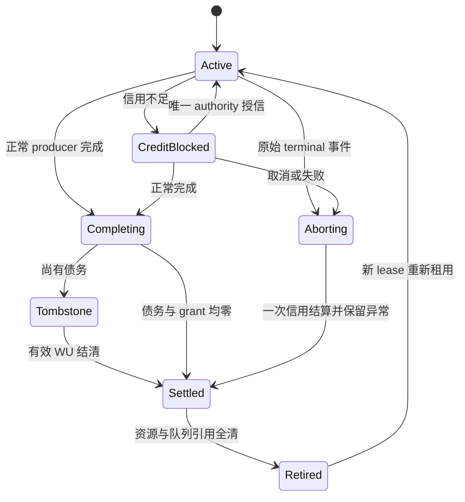

# Issue #735：成熟框架源码审计与 A / B / C / D 架构评审

审计日期：2026-10-11 UTC。SharpLink 基线固定为 [`dev@f8ba89121c87a6410a0139c44d7db30eab877f41`](https://github.com/SunSi12138/SharpLink/tree/f8ba89121c87a6410a0139c44d7db30eab877f41)，包含已经合并的 #840、#841 和 #842。本文件是架构与机制证据附件；完整 SharpLink 历史性能审计、实际 RPC 样本与最终验收结论由同目录总报告给出。

## 1. 审计结论及证据边界

目前源码证据支持三个判断：

1. **单 owner 的收益来自减少跨线程交接，以及在 owner 内完成一批工作。** Netty 在一次 byte allocation 内连续写多个 frame，最后结算本批窗口；Kestrel 排入去重后的 producer 写入意图，数据留在 stream Pipe；MsQuic 合并一条 stream 的多个 API send，再合并连接 flush。它们没有证明“在现有发送路径外给每个 item 再增加 queue、completion 和 callback”能获得相同收益。
2. **grant、协议窗口和准备缓冲是不同资源。** Rust h2 给出了连接可用额度向 stream grant 转移的明确实现；gRPC-Go 的 writeQuota 则限制待处理数据，不是第二份协议额度。SharpLink 可以从这些所有权划分获得启发，但必须保留 #840 的有效 stream delta、oversized 借用、现有预算和池化 generation 规则。
3. **取消和阻塞 I/O 决定候选能否生产使用。** h2 的已合并修复包括取消后漏还 grant、RST 被零窗口 DATA 永久挡住、持锁 socket Flush；Kestrel 和 gRPC-Go 的历史还包括重复等待者与双边停止读取。它们说明公平、取消结算、reader progress、writer-owned 缓冲退役应在性能调参之前解决。

这些判断的具体源码与讨论见下文。没有一个所审框架可以准确概括成“完全无锁”。本报告没有重新运行外部框架测试，也没有把它们的历史收益换算成 SharpLink 的收益。

### 1.1 证据分类

| 分类 | 本文件中有什么 | 能证明什么 | 不能证明什么 |
| --- | --- | --- | --- |
| 固定源码审计 | 六个框架的 owner、队列、窗口、生命周期及关键历史修复 | 具体实现及可迁移原则 | SharpLink 的 CPU、B/RPC、吞吐改善 |
| 外部历史测量 | Kestrel PR、gRPC-Go PR、h2 PR 原作者结果 | 对应版本和负载下的历史现象 | 本任务复现、同机 SharpLink A/B、NativeAOT |
| 本轮串行模型 | 新写 B2 守恒 oracle，20 项检查、27 行逻辑计数 | 原子事件模型的守恒、计数、被否定的错误设计 | .NET 并发线性化、真实锁次数、发送性能 |
| 本轮 D 生产控制 | 当前 dev 的 send / receive gate 分离，保持实际发送路径 | 需要实际 RPC 与测试结果判定 | B2 或 B3 已经接入、尚未出炉的 Go |
| 对象分配诊断 | 真实 controller，JIT PGO ON/OFF 与实际 NativeAOT；首次编译失败保留 | 限定作用域内 constructor / 状态 / waiter / churn 分配 | 常驻 RSS、所有线程分配、RPC 性能 |

研究模型、相同 transport harness、生成式完整 RPC、实际发布执行的 NativeAOT，以及 NativeAOT smoke test 是五种不同证据。任何一项成功不能替代另一项。

## 2. 固定版本

| 框架 | 本次读取分支 | 固定 commit |
| --- | --- | --- |
| Netty | 维护中的 4.1 | [`fd477200638314fe2eb5beb8b3a6a3fb6e6bbeab`](https://github.com/netty/netty/tree/fd477200638314fe2eb5beb8b3a6a3fb6e6bbeab) |
| MsQuic | main | [`52d3fb9663e5baa8d4747f20897370b05fad7e4a`](https://github.com/microsoft/msquic/tree/52d3fb9663e5baa8d4747f20897370b05fad7e4a) |
| ASP.NET Core | main | [`5c7435fed2e17a0f82f432e1dc40b695af31c531`](https://github.com/dotnet/aspnetcore/tree/5c7435fed2e17a0f82f432e1dc40b695af31c531) |
| gRPC-Go | master | [`8c59ee6356bf92d0a5819b0cdbd3118876783028`](https://github.com/grpc/grpc-go/tree/8c59ee6356bf92d0a5819b0cdbd3118876783028) |
| Rust h2 | master | [`e64c1662ebb14794fc19cbcbb5b5dd0f67925f27`](https://github.com/hyperium/h2/tree/e64c1662ebb14794fc19cbcbb5b5dd0f67925f27) |
| tonic，canonical 仓库 grpc/grpc-rust | master | [`988d4d74b1fdb1bddd3e003598c5d2c719352eed`](https://github.com/grpc/grpc-rust/tree/988d4d74b1fdb1bddd3e003598c5d2c719352eed) |

这是可核实源码快照，不是对所有项目“最新稳定发行版”的声明。读取 `hyperium/tonic` 仓库元数据返回 canonical repository `grpc/grpc-rust`，所以 tonic 使用后者永久链接。Netty / MsQuic 的 28 个完整源码文件另保留 Git blob SHA 校验记录；其他框架保留固定 commit、path、blob SHA、原始 discussion / review 返回。以下分析以最终代码为准，避免把 PR 正文中已经变更的设计当作最终实现。

## 3. 横向比较：owner、调度单位与资源语义

| 实现 | 连接信用的实际 owner | producer 如何提交 | 调度与公平的单位 | 需要保留的限制 |
| --- | --- | --- | --- | --- |
| Netty HTTP/2 | Channel EventLoop，controller 要求单线程调用 | owner 上直接调用；跨线程为 WriteTask / executor；stream 内有 pending frame deque | Uniform 最小 byte chunk、Weighted virtual bytes；默认 quantum / min chunk 1 KiB | 上游仍有 stream 查找；跨线程任务和 outbound 原子记账存在；水位不是硬缓冲 cap |
| Kestrel HTTP/2 | 一个 DATA writer loop；read/control 路径仍以 window / write locks 同步 | stream Pipe + 去重 producer ready channel | 一次取可用 Pipe bytes 与双窗口最小值，再分 HTTP/2 frame | 多个锁仍存在；窗口更新可唤醒整个 wait queue；取消完成契约独立于排队 |
| MsQuic | 同一时刻一个 connection worker，可迁移 | 每调用池化 request + stream API lock；只在空到非空时排 operation | 16 operations / connection drain；同优先级 RR 为 8 packets | operation queue / worker queue 仍有锁；buffer IdealBytes 是软目标；callback 阻塞 owner |
| gRPC-Go | loopyWriter goroutine | dataFrame + soft writeQuota + mutex controlBuffer | 每次处理一个 message 的至多 16 KiB 部分，再流内 / 流间轮转 | 小 message 可以逐 item 轮转，但轮转在 writer 内；done 不等于 writer cleanup join |
| Rust h2 | connection Future 驱动；producer 与 driver 共享 Mutex 状态 | saved store key + Inner / SendBuffer 两锁 | connection capacity 分配给 stream；intrusive ready / capacity queues | grant 不代表免除连接级锁；调用者仍须遵守 capacity 背压；生命周期包含队列和 in-flight |
| tonic | RPC 编码层 + hyper connection Future | EncodeBytes 聚合当前 ready message，产出 body bytes | RPC message、body chunk、HTTP/2 frame 是不同单位 | 序列化 / 压缩 CPU 必须计入完整路径，不能与预编码 microkernel 等同 |

表中数字来自下列固定代码；它们不是 SharpLink 建议默认值。尤其不能把 1 KiB、16 KiB、8 packets 或 Pipe read 一律译成 `quantum = 16 items`。

## 4. Netty HTTP/2：单 owner 的边界与真正的批处理

### 4.1 流绑定状态没有消除所有上游查找

[`DefaultHttp2RemoteFlowController`](https://github.com/netty/netty/blob/fd477200638314fe2eb5beb8b3a6a3fb6e6bbeab/codec-http2/src/main/java/io/netty/handler/codec/http2/DefaultHttp2RemoteFlowController.java#L38-L98) 和 [`DefaultHttp2LocalFlowController`](https://github.com/netty/netty/blob/fd477200638314fe2eb5beb8b3a6a3fb6e6bbeab/codec-http2/src/main/java/io/netty/handler/codec/http2/DefaultHttp2LocalFlowController.java#L36-L122) 都规定单线程，通常为 EventLoop。`inEventLoop` 断言是调用契约，不是多线程互斥。Remote 为 connection stream 与每个 stream 绑定 `FlowState`，`state(stream)` 通过 property 访问。

但 [`DefaultHttp2ConnectionEncoder.writeData`](https://github.com/netty/netty/blob/fd477200638314fe2eb5beb8b3a6a3fb6e6bbeab/codec-http2/src/main/java/io/netty/handler/codec/http2/DefaultHttp2ConnectionEncoder.java#L125-L147) 仍调用 `requireStream(streamId)`。因此应归因成“controller 内不再重复查找”，而不是整条发送路径完全不查表。每个 FlowState 的 window、pendingBytes、deque、writing / cancelled 状态，见 [L272–290](https://github.com/netty/netty/blob/fd477200638314fe2eb5beb8b3a6a3fb6e6bbeab/codec-http2/src/main/java/io/netty/handler/codec/http2/DefaultHttp2RemoteFlowController.java#L272-L290)。

HTTP/2 remote credit 是独立的 stream / connection WINDOW_UPDATE 余额；`pendingBytes` 表示尚未写出的 backlog，用于 writable 通知，不能作为另一份 spendable credit。SETTINGS 下调导致的负流窗口是 HTTP/2 语义，不能用来放松 SharpLink 的 oversized 规则。

### 4.2 每次 allocation 处理多个 frame，最后结算

[`FlowState.writeAllocatedBytes`](https://github.com/netty/netty/blob/fd477200638314fe2eb5beb8b3a6a3fb6e6bbeab/codec-http2/src/main/java/io/netty/handler/codec/http2/DefaultHttp2RemoteFlowController.java#L339-L399) 在一次 `writing` 生命周期内循环处理队首 frame，受 allocation、stream window 与 connection window 限制。消费完一个 frame 后先从队列删除，再调用 `writeComplete`，避免回调重入取消又将同一 frame 失败一次。用 frame size 前后差计算实际写出量，在 `finally` 一次性减少本批 pending bytes 及双层窗口。

这才是可以迁移的摊销边界：writer 已经有数据、已经拥有信用状态，在一次进入后完成一批工作。它并不需要逐 frame 离开 owner 去等待一个 producer completion，再返回 owner 继续下一 frame。

入队 [L431–450](https://github.com/netty/netty/blob/fd477200638314fe2eb5beb8b3a6a3fb6e6bbeab/codec-http2/src/main/java/io/netty/handler/codec/http2/DefaultHttp2RemoteFlowController.java#L431-L450) 尝试与队尾合并。encoder 的 [`FlowControlledData`](https://github.com/netty/netty/blob/fd477200638314fe2eb5beb8b3a6a3fb6e6bbeab/codec-http2/src/main/java/io/netty/handler/codec/http2/DefaultHttp2ConnectionEncoder.java#L469-L566) 仍创建 `CoalescingBufferQueue`、写 promise 和 listener。merge 可以减少下游工作，并不消除这些入口成本。

[`AbstractChannelHandlerContext.write`](https://github.com/netty/netty/blob/fd477200638314fe2eb5beb8b3a6a3fb6e6bbeab/transport/src/main/java/io/netty/channel/AbstractChannelHandlerContext.java#L963-L995) 在 EventLoop 上直接调用；跨线程使用 [`WriteTask`](https://github.com/netty/netty/blob/fd477200638314fe2eb5beb8b3a6a3fb6e6bbeab/transport/src/main/java/io/netty/channel/AbstractChannelHandlerContext.java#L1206-L1289)，包含 pending-byte 增减及回收。下层 [`ChannelOutboundBuffer`](https://github.com/netty/netty/blob/fd477200638314fe2eb5beb8b3a6a3fb6e6bbeab/transport/src/main/java/io/netty/channel/ChannelOutboundBuffer.java#L190-L237) 仍有原子 pending-byte 更新；writable 切换见 [CAS 路径 L637–654](https://github.com/netty/netty/blob/fd477200638314fe2eb5beb8b3a6a3fb6e6bbeab/transport/src/main/java/io/netty/channel/ChannelOutboundBuffer.java#L637-L654)。

### 4.3 公平性不是机械的 item round-robin

[`UniformStreamByteDistributor.distribute`](https://github.com/netty/netty/blob/fd477200638314fe2eb5beb8b3a6a3fb6e6bbeab/codec-http2/src/main/java/io/netty/handler/codec/http2/UniformStreamByteDistributor.java#L67-L121) 使用 `max(minAllocationChunk, maxBytes / queueSize)`，最低块默认 1 KiB。state 的 queued 位去重，负流窗口被跳过；关闭时 `ArrayDeque.remove(this)` 最坏 O(ready streams)，见 [L142–199](https://github.com/netty/netty/blob/fd477200638314fe2eb5beb8b3a6a3fb6e6bbeab/codec-http2/src/main/java/io/netty/handler/codec/http2/UniformStreamByteDistributor.java#L142-L199)。

[`WeightedFairQueueByteDistributor`](https://github.com/netty/netty/blob/fd477200638314fe2eb5beb8b3a6a3fb6e6bbeab/codec-http2/src/main/java/io/netty/handler/codec/http2/WeightedFairQueueByteDistributor.java#L258-L340) 以 virtual bytes、权重和下一节点虚拟时间差加 quantum 决定本次 allocation；实际写出量推进 pseudo time，见 [L659–688](https://github.com/netty/netty/blob/fd477200638314fe2eb5beb8b3a6a3fb6e6bbeab/codec-http2/src/main/java/io/netty/handler/codec/http2/WeightedFairQueueByteDistributor.java#L659-L688)。无进展流可变 inactive。它还需要优先级树、map、heap 和 active-count 维护；默认保留 5 个 state-only priority 节点只限制优先级元数据，不限制 DATA backlog。

历史 [#14918](https://github.com/netty/netty/issues/14918#issuecomment-2714719229) 解释了过小均摊产生 1-byte frame 的 goodput 问题；[#4462](https://github.com/netty/netty/pull/4462#issuecomment-156925417) 使用 bytes written 的 pseudo time；[#4266](https://github.com/netty/netty/issues/4266) / [#4282](https://github.com/netty/netty/pull/4282) 记录未使用 sibling allocation 没有重分配的错误。#4282 对应修复以 [`93011dd3159e2371d583e84ffae3fa6eac4ed723`](https://github.com/netty/netty/commit/93011dd3159e2371d583e84ffae3fa6eac4ed723) cherry-pick 落地，不把 PR 的 merge 字段空值描述为直接合并。

### 4.4 取消、late update 与 Flush 失败历史

Remote [`cancel`](https://github.com/netty/netty/blob/fd477200638314fe2eb5beb8b3a6a3fb6e6bbeab/codec-http2/src/main/java/io/netty/handler/codec/http2/DefaultHttp2RemoteFlowController.java#L470-L520) 在 writing 时只标记，等当前写出量结算后才 drain / error 剩余队列。Local 在 stream close 时把尚未消费量归还 connection，再换为共享 reduced state；[`returnProcessedBytes`](https://github.com/netty/netty/blob/fd477200638314fe2eb5beb8b3a6a3fb6e6bbeab/codec-http2/src/main/java/io/netty/handler/codec/http2/DefaultHttp2LocalFlowController.java#L432-L484) 拒绝过量归还。decoder 对适用的已关闭流 late WINDOW_UPDATE 验证后忽略，见 [L713–726](https://github.com/netty/netty/blob/fd477200638314fe2eb5beb8b3a6a3fb6e6bbeab/codec-http2/src/main/java/io/netty/handler/codec/http2/DefaultHttp2ConnectionDecoder.java#L713-L726)。HTTP/2 stream ID 不复用，不能用这个行为替代 SharpLink 本地对象池 lease / 同 key 生命周期证明。

[`Http2ConnectionHandler.flush`](https://github.com/netty/netty/blob/fd477200638314fe2eb5beb8b3a6a3fb6e6bbeab/codec-http2/src/main/java/io/netty/handler/codec/http2/Http2ConnectionHandler.java#L194-L239) 由 `inFlush + flushAgain` 处理重入；这里没有 await 一个长时间不完成的 PipeWriter Flush。channel 可写性是再次进入 owner 的事件。remote 的 channel allowance [L237–261](https://github.com/netty/netty/blob/fd477200638314fe2eb5beb8b3a6a3fb6e6bbeab/codec-http2/src/main/java/io/netty/handler/codec/http2/DefaultHttp2RemoteFlowController.java#L237-L261) 使用水位和最低 32 KiB 启发式，是软背压。

两个历史教训必须同时保留：

- [#17266](https://github.com/netty/netty/pull/17266)，合并 [`1ec9af210847dfe22e6cd9857d54edb362bc7e85`](https://github.com/netty/netty/commit/1ec9af210847dfe22e6cd9857d54edb362bc7e85)，抑制 flush 重入；随后 [#17279](https://github.com/netty/netty/pull/17279)，合并 [`67896b2e7ee547c467e25ed0d9892527160e5843`](https://github.com/netty/netty/commit/67896b2e7ee547c467e25ed0d9892527160e5843)，修复信号被吞导致大 body 尾部搁置。原始 [#17256](https://github.com/netty/netty/issues/17256) 的全部线上成因仍有讨论，本审计不声称独立复现它。
- [#16946](https://github.com/netty/netty/issues/16946) / [#16947](https://github.com/netty/netty/pull/16947)，合并 [`a5d4f289e914c3d6b5b78ac31583e6f95312d8f4`](https://github.com/netty/netty/commit/a5d4f289e914c3d6b5b78ac31583e6f95312d8f4)，针对 buffer reported size 与实际可读量失配。最终代码在 encoder 做 under-delivery 检查并协调队列 byte count；PR 正文所写通用 controller no-progress guard 不是最终实现。buffer 所有权错误不能靠调度参数修复。

## 5. Kestrel：区分问题、TLS 隔离和 producer channel 三个阶段

### 5.1 历史收益究竟来自什么

| 历史节点 | 实际变更 / 证据 | 不能作出的推论 |
| --- | --- | --- |
| [#30235](https://github.com/dotnet/aspnetcore/issues/30235) | 多 stream 竞争 frame-writer lock；独立 Channel vs SemaphoreSlim 示例约 3 倍。评论 [800532923](https://github.com/dotnet/aspnetcore/issues/30235#issuecomment-800532923) 已说明窗口 owner 也须迁移 | 这不是真实 gRPC E2E，也不证明 Channels 无锁 |
| [#40407](https://github.com/dotnet/aspnetcore/pull/40407)，merge [`8af64207b1ebd21aca1b423af3dd0bb386fab4f2`](https://github.com/dotnet/aspnetcore/commit/8af64207b1ebd21aca1b423af3dd0bb386fab4f2) | Http2Connection 新增 output Pipe / copy loop，把昂贵 SslStream.WriteAsync 移出 frame-writer 竞争范围；历史 gRPC TLS、70 streams / 1 conn：14,485 → 86,983 RPS | 这不是完整 producer-ready channel 改造；没有相同 TLS 锁瓶颈不能套用 +500.49% |
| [#40925](https://github.com/dotnet/aspnetcore/pull/40925)，merge [`1b02b8549618c0edd7022362617251d9d1c33152`](https://github.com/dotnet/aspnetcore/commit/1b02b8549618c0edd7022362617251d9d1c33152) | 去重 producer 写入意图，去掉 per-stream ProcessDataWrites；历史 Unary 70 streams：98,685 → 286,732 RPS；lock contention/s 16,862 → 369，ThreadPool items/s 却 261,988 → 417,645 | 锁争用降低不等于全部调度降低；不能与前一 PR 百分比相加 / 相乘 |

#40407 [评论 1050479464](https://github.com/dotnet/aspnetcore/pull/40407#issuecomment-1050479464) 同时给出 h2c 控制，以及 TCP 背压时额外约 64 KiB Pipe 缓冲和一次 copy。#40925 c1 历史 RPS 为 9,673 → 9,824；[多连接评论 1100599351](https://github.com/dotnet/aspnetcore/pull/40925#issuecomment-1100599351) 为 691,033 → 767,863，CPU 83% → 96%。这些是原作者历史测量，缺少本任务要求的同机逐轮原样本和 AOT；这里只据此定位机制。

### 5.2 当前 writer、流状态和锁

[`Http2FrameWriter`](https://github.com/dotnet/aspnetcore/blob/5c7435fed2e17a0f82f432e1dc40b695af31c531/src/Servers/Kestrel/Core/src/Internal/Http2/Http2FrameWriter.cs#L73-L220) 保留 write lock、connection-window lock、ready channel、window waiter queue，以及单 DATA writer task。producer 写 [`Http2OutputProducer` 的 Pipe](https://github.com/dotnet/aspnetcore/blob/5c7435fed2e17a0f82f432e1dc40b695af31c531/src/Servers/Kestrel/Core/src/Internal/Http2/Http2OutputProducer.cs#L521-L549)，[`Schedule`](https://github.com/dotnet/aspnetcore/blob/5c7435fed2e17a0f82f432e1dc40b695af31c531/src/Servers/Kestrel/Core/src/Internal/Http2/Http2OutputProducer.cs#L293-L340) 用 `_isScheduled` 去重，并在 stream window 不足时暂停 DATA 调度。

一次 drain 消费 `min(buffered bytes, stream window, connection window)`，之后按 HTTP/2 frame-size 切帧；不是固定 16 个 RPC item。正常 producer 路径显式可见一个外层 `_dataWriterLock`，`EnqueueDataWrite` / `Schedule` 各有同锁的重入获取。正常 writer drain 在 `CompletedResponse`、`CheckStreamWindow`、`ConsumeStreamWindow`、`UnobservedState`、`CurrentState`、`ObserveDataAndState` 六处获取 stream lock，连接窗口检查 / 消耗又各取 window lock，写帧还有 write lock。**这是按 drain 的静态调用路径，不是每 item 九把锁，也未计 Pipe / Channel 内部成本。**

[`Flush` L781–841](https://github.com/dotnet/aspnetcore/blob/5c7435fed2e17a0f82f432e1dc40b695af31c531/src/Servers/Kestrel/Core/src/Internal/Http2/Http2FrameWriter.cs#L781-L841) 在 write lock 内取得 ValueTask，锁外 await；完成后才推进 Pipe reader。ConcurrentPipeWriter 可以在 pending flush 时追加控制帧，但不能凭空解除物理 socket 阻塞。stream Pipe [pause 4096 / resume 2048](https://github.com/dotnet/aspnetcore/blob/5c7435fed2e17a0f82f432e1dc40b695af31c531/src/Servers/Kestrel/Core/src/Internal/Http2/Http2OutputProducer.cs#L768-L781) 是阈值，不是任意大小写入下精确的全连接硬 cap。

### 5.3 公平、取消和队列上限

[`_lastWindowConsumer`](https://github.com/dotnet/aspnetcore/blob/5c7435fed2e17a0f82f432e1dc40b695af31c531/src/Servers/Kestrel/Core/src/Internal/Http2/Http2FrameWriter.cs#L365-L386) 延后吃完最后窗口的 producer，使它在下次排到尾部；connection WU [L1094–1121](https://github.com/dotnet/aspnetcore/blob/5c7435fed2e17a0f82f432e1dc40b695af31c531/src/Servers/Kestrel/Core/src/Internal/Http2/Http2FrameWriter.cs#L1094-L1121) 仍会唤醒整个等待队列。它不是严格等字节公平，也不保证无 wake storm。

提交 DATA 前观察 abort 时，writer [只恢复暂扣的 actual connection credit](https://github.com/dotnet/aspnetcore/blob/5c7435fed2e17a0f82f432e1dc40b695af31c531/src/Servers/Kestrel/Core/src/Internal/Http2/Http2FrameWriter.cs#L240-L265)。[`OutputProducer.Stop`](https://github.com/dotnet/aspnetcore/blob/5c7435fed2e17a0f82f432e1dc40b695af31c531/src/Servers/Kestrel/Core/src/Internal/Http2/Http2OutputProducer.cs#L572-L654) 必须再次调度被信用阻塞的流处理 abort；request processing 与 response writer 都结束才允许完整退役，回调在锁外。[`ShutdownAsync`](https://github.com/dotnet/aspnetcore/blob/5c7435fed2e17a0f82f432e1dc40b695af31c531/src/Servers/Kestrel/Core/src/Internal/Http2/Http2FrameWriter.cs#L438-L478) 关闭 channel 并 join writer，还明确避免 write-lock → stream-lock 的反序调用。

#40925 的具体评审直接适用于 SharpLink：

- [846502757](https://github.com/dotnet/aspnetcore/pull/40925#discussion_r846502757)：WU 全唤醒后的重复调度与公平问题。
- [846532981](https://github.com/dotnet/aspnetcore/pull/40925#discussion_r846532981)：stream 和 connection 同时耗尽，可能重复加入 connection waiter。
- [848008903](https://github.com/dotnet/aspnetcore/pull/40925#discussion_r848008903)：CompleteAsync 表示 queued 还是 written，会改变后续 Reset / Abort 顺序。
- [848962878](https://github.com/dotnet/aspnetcore/pull/40925#discussion_r848962878)：gRPC status trailers 先 flush 再 RST(NO_ERROR)，不能所有 terminal 一概优先。
- [846438634](https://github.com/dotnet/aspnetcore/pull/40925#discussion_r846438634)：队列必须有明确上限。

仍开放的 [#51309](https://github.com/dotnet/aspnetcore/issues/51309) 讨论关闭流从 connection waiter queue 剔除；现实现 [超过上限会 abort connection](https://github.com/dotnet/aspnetcore/blob/5c7435fed2e17a0f82f432e1dc40b695af31c531/src/Servers/Kestrel/Core/src/Internal/Http2/Http2FrameWriter.cs#L1123-L1133)。SharpLink 要求正常单流取消不无故使连接故障，不能用这个策略替代正确 unlink、去重、generation 与资源退役。

## 6. MsQuic：worker owner、跨线程合并与分阶段退役

### 6.1 owner 不是所有 API 都无队列

[`Execution.md` L53–89](https://github.com/microsoft/msquic/blob/52d3fb9663e5baa8d4747f20897370b05fad7e4a/docs/Execution.md#L53-L89) 规定同一 connection 及其 streams 在同一时刻由一个 worker 执行，可迁移，app callback 不并行且占用协议 worker。长 callback 会阻塞连接推进。

[`MsQuicStreamSend`](https://github.com/microsoft/msquic/blob/52d3fb9663e5baa8d4747f20897370b05fad7e4a/src/core/api.c#L1155-L1358) 每次从 SendRequestPool 租 request，在 `ApiSendRequestLock` 下验证并追加。只有 no buffering、合适执行级别且当前就是 connection worker 等条件成立才 inline；默认调用不能假定没有提交成本。API 链由空变非空才排 stream send operation；已非空则合并。该版本追加仍遍历链找 tail，积压 n 个 request 时单次最坏 O(n)。

[`QuicStreamSendFlush`](https://github.com/microsoft/msquic/blob/52d3fb9663e5baa8d4747f20897370b05fad7e4a/src/core/stream_send.c#L596-L668) 一次持锁摘走整个 API request 链，owner 内处理全部请求。连接 [`QuicSendQueueFlush`](https://github.com/microsoft/msquic/blob/52d3fb9663e5baa8d4747f20897370b05fad7e4a/src/core/send.c#L137-L200) 用 `FlushOperationPending` 去重；stream ready list 只插入尚未在链上的流，并持 SEND reference。

[`operation.c`](https://github.com/microsoft/msquic/blob/52d3fb9663e5baa8d4747f20897370b05fad7e4a/src/core/operation.c#L145-L242) 的 enqueue / dequeue 都持锁；[`QuicWorkerQueueConnection`](https://github.com/microsoft/msquic/blob/52d3fb9663e5baa8d4747f20897370b05fad7e4a/src/core/worker.c#L255-L289) 也有 worker lock、去重、引用和 idle wake。减少的是每批 connection 入 worker 队列和唤醒，不能写成每 item 没有同步。

已接受 StreamSend、但后续 operation 分配失败时，当前 [L1300–1334](https://github.com/microsoft/msquic/blob/52d3fb9663e5baa8d4747f20897370b05fad7e4a/src/core/api.c#L1300-L1334) 使用 backup operation 终止连接，以免错误地报告未接受。这是极端 OOM 策略，不是 SharpLink 普通单流取消的范例。

### 6.2 多层量子与独立控制进展

[`quicdef.h` L190–212](https://github.com/microsoft/msquic/blob/52d3fb9663e5baa8d4747f20897370b05fad7e4a/src/core/quicdef.h#L190-L212) 定义每轮 connection drain 16 operations、RR 8 packets、receive batch 32 packets、flush 40 datagrams hint。最后一项可因填满 USO buffer 超出，不是硬 cap。

[`QuicConnDrainOperations`](https://github.com/microsoft/msquic/blob/52d3fb9663e5baa8d4747f20897370b05fad7e4a/src/core/connection.c#L8059-L8227) 有界处理后重新排连接；未完成 flush 可复用同一 operation 放回队尾；预算用尽时 ACK 有立即 flush 特殊处理。[`QuicSendGetNextStream`](https://github.com/microsoft/msquic/blob/52d3fb9663e5baa8d4747f20897370b05fad7e4a/src/core/send.c#L1011-L1069) 跳过 blocked 流，但源码承认反复扫描 blocked 流的成本。RR 仅限同优先级组，FIFO 可持续当前流；不等于全流严格 FIFO 或跨优先级无饥饿证明。构帧次序见 [control → PMTU → stream](https://github.com/microsoft/msquic/blob/52d3fb9663e5baa8d4747f20897370b05fad7e4a/src/core/send.c#L1370-L1450)。

### 6.3 绝对 offset 信用不能照搬为 Protocol v2 增量信用

[`QuicStreamSendWrite`](https://github.com/microsoft/msquic/blob/52d3fb9663e5baa8d4747f20897370b05fad7e4a/src/core/stream_send.c#L966-L1073) 的发送右边界取 stream 最大 offset 与 connection 可用量的较小值；只有超过该 stream 已发送最大 offset 的新字节增加 `OrderedStreamBytesSent`，重传不重复扣。

因此可写作 `RemainingConnectionCredit + OrderedStreamBytesSent = PeerMaxData`。[`MAX_DATA`](https://github.com/microsoft/msquic/blob/52d3fb9663e5baa8d4747f20897370b05fad7e4a/src/core/connection.c#L4864-L4895) 仅接受更大的单调值，清 blocked 原因并合并 flush。SharpLink WU 是增量归还且包含 oversized / tombstone 语义，不能依赖绝对值去重的证明。

[`docs/Streams.md`](https://github.com/microsoft/msquic/blob/52d3fb9663e5baa8d4747f20897370b05fad7e4a/docs/Streams.md#L33-L76) 规定 SEND_COMPLETE 只是返回 buffer ownership，不代表对端应用已接收。buffering mode 可以 copy 后提早完成；no-buffer mode 仅一个 outstanding send 会在 completion 到下次 enqueue 间闲置。它解释了“producer 每 item 等 writer completion”可能导致量子有名无实。[`send_buffer.c` L8–53](https://github.com/microsoft/msquic/blob/52d3fb9663e5baa8d4747f20897370b05fad7e4a/src/core/send_buffer.c#L8-L53) 的 IdealBytes 可被超过，每流 ideal 也可能合计过大，不能当作 SharpLink 硬准备预算。

### 6.4 先封 producer，回调、队列与引用各自结算

[`QuicStreamSendShutdown`](https://github.com/microsoft/msquic/blob/52d3fb9663e5baa8d4747f20897370b05fad7e4a/src/core/stream_send.c#L114-L242) 在 API lock 下禁发并摘 API 链；取消先完成已进入 send queue 的请求，再处理 API 链，send-cancelled callbacks 先于 send-shutdown-complete。[`QuicStreamCompleteSendRequest`](https://github.com/microsoft/msquic/blob/52d3fb9663e5baa8d4747f20897370b05fad7e4a/src/core/stream_send.c#L413-L473) 用原 client context 回调、释放内部 buffer、更新 PostedBytes、回池 request。

[`QuicStreamTryCompleteShutdown`](https://github.com/microsoft/msquic/blob/52d3fb9663e5baa8d4747f20897370b05fad7e4a/src/core/stream.c#L624-L653) 还等待本地 / 远端关闭及 pending receive 条件。[`stream_set.c`](https://github.com/microsoft/msquic/blob/52d3fb9663e5baa8d4747f20897370b05fad7e4a/src/core/stream_set.c#L233-L297) 从 lookup 移除后先入 ClosedStreams，在 owner drain 的安全点释放 reference。移出表不等于立即复用对象。

[ConnectionClose API](https://github.com/microsoft/msquic/blob/52d3fb9663e5baa8d4747f20897370b05fad7e4a/src/core/api.c#L154-L245) 的同 worker inline 与外部排队等待路径有不同前提。[#1668](https://github.com/microsoft/msquic/issues/1668#issuecomment-852191673) 通过日志定位 app callback 阻塞 owner、外部 close 等待；调用方改变关闭方式后解决。仍开放的 [#5126](https://github.com/microsoft/msquic/issues/5126) 是外部单线程 execution teardown 等待 rundown 而同线程不能继续 cleanup；[#5127](https://github.com/microsoft/msquic/pull/5127) 仍未合并且承认平台实现不完整。不能把这些未合并路径写成已经验证的关闭方案。

## 7. gRPC-Go：writer 内轮转与每 message 提交仍可并存

### 7.1 owner、队列与额度

[`controlBuffer`](https://github.com/grpc/grpc-go/blob/8c59ee6356bf92d0a5819b0cdbd3118876783028/internal/transport/controlbuf.go#L364-L455) 使用 mutex，wake channel 容量 1，仅 consumer waiting 时通知。[`outStream`](https://github.com/grpc/grpc-go/blob/8c59ee6356bf92d0a5819b0cdbd3118876783028/internal/transport/controlbuf.go#L292-L364) 保存 item queue、bytesOutstanding、writeQuota、reader 和 intrusive active links；writer 的 [`sendQuota` / `oiws` / stream table](https://github.com/grpc/grpc-go/blob/8c59ee6356bf92d0a5819b0cdbd3118876783028/internal/transport/controlbuf.go#L563-L618) 是协议发送状态。

[`loopyWriter.run`](https://github.com/grpc/grpc-go/blob/8c59ee6356bf92d0a5819b0cdbd3118876783028/internal/transport/controlbuf.go#L620-L700) 每处理一个 control item 后服务 DATA，control 暂空仍可继续 DATA；没有即时进展才 flush。小于 1000 buffered bytes 时最多一次 Gosched 扩大 batch。[`processData`](https://github.com/grpc/grpc-go/blob/8c59ee6356bf92d0a5819b0cdbd3118876783028/internal/transport/controlbuf.go#L994-L1096) 一次处理一个 dataFrame 的至多 `min(16 KiB, stream quota, connection quota)`，再轮转。

一个 dataFrame 对应一次已编码 message，16 KiB 不是 16 条 message。小消息仍可能逐 item 轮转；关键是轮转发生在同一 writer 内，没有每次轮转一次 producer Task / TCS 交接。

[`http2Client.Write`](https://github.com/grpc/grpc-go/blob/8c59ee6356bf92d0a5819b0cdbd3118876783028/internal/transport/http2_client.go#L1129-L1157) 仍检查状态、构造 dataFrame、获取 writeQuota、BufferSlice.Ref，再 `controlBuf.put`，失败时 Free。[`writeQuota`](https://github.com/grpc/grpc-go/blob/8c59ee6356bf92d0a5819b0cdbd3118876783028/internal/transport/flowcontrol.go#L28-L78) 是软限制：只要当前 quota > 0 就减整 message，允许变负，默认 [64 KiB](https://github.com/grpc/grpc-go/blob/8c59ee6356bf92d0a5819b0cdbd3118876783028/internal/transport/defaults.go#L43-L46)。writer 处理后补回准备容量，不等待对端 WU。它与 protocol credit 分别计量不同资源，没有复制协议额度。

静态 producer 路径可见 quota load / atomic add、一次 mutex enqueue；writer 又有 mutex dequeue、stream map 查找、本地 item queue 和 active list；每个 chunk replenish 有 atomic add。BufferSlice Ref / Free 次数取决于 segment 数，不能写成固定一次。当前 [lazy ring itemList](https://github.com/grpc/grpc-go/blob/8c59ee6356bf92d0a5819b0cdbd3118876783028/internal/transport/controlbuf.go#L41-L124) 初始 4、扩容 / 缩容；[#9444](https://github.com/grpc/grpc-go/pull/9444) 于 2026-10-08 合并，消除链节点成本，但不是消除所有 per-message 对象或同步。其 Go 1.26.6 / bufconn 历史结果是完整 gRPC 内存传输测量，不是 TCP / SharpLink / .NET NativeAOT。

### 7.2 取消完成点与双边停读死锁

流窗口耗尽时移出 active list，[WU 再激活](https://github.com/grpc/grpc-go/blob/8c59ee6356bf92d0a5819b0cdbd3118876783028/internal/transport/controlbuf.go#L707-L723)。连接窗口耗尽不阻止 loopy 处理 controlBuf；但物理 Flush 已阻塞时，这个 goroutine 也不能继续执行所有新 command。

[`cleanupStreamHandler`](https://github.com/grpc/grpc-go/blob/8c59ee6356bf92d0a5819b0cdbd3118876783028/internal/transport/controlbuf.go#L863-L889) 由 writer 删除状态、reader、active 链和未处理数据再发 RST；[`finish`](https://github.com/grpc/grpc-go/blob/8c59ee6356bf92d0a5819b0cdbd3118876783028/internal/transport/controlbuf.go#L518-L553) 关闭 admission 并清 orphan buffers。客户端 [`closeStream`](https://github.com/grpc/grpc-go/blob/8c59ee6356bf92d0a5819b0cdbd3118876783028/internal/transport/http2_client.go#L967-L1023) 先唯一设置 streamDone / 原 status，再排 cleanup，最后 close(done)。**done 不代表 writer cleanup 已执行。** SharpLink 若承诺取消完成时 prepared budget 已结算，不能照抄此时序而改变契约。

连接 [`Close`](https://github.com/grpc/grpc-go/blob/8c59ee6356bf92d0a5819b0cdbd3118876783028/internal/transport/http2_client.go#L1028-L1098) 使用 deadline、socket close、reader / keepalive join；[#8425](https://github.com/grpc/grpc-go/issues/8425#issuecomment-3057938248) 指出 write error 不保证 reader 同时醒来。

2026-09-24 的 [#9431](https://github.com/grpc/grpc-go/pull/9431) 移除 client 因 controlBuf 长度而停读，避免与 server 停读形成相互等待。[#9433](https://github.com/grpc/grpc-go/pull/9433) 将 server throttle 收窄到 peer-induced control 类别，并改变其阈值。可迁移的是依赖图原则：出站准备预算不足，不能禁止接收 WU / Cancel。不能迁移其具体 100 → 10000 资源策略。

[#5393](https://github.com/grpc/grpc-go/issues/5393#issuecomment-1148851417) 最后指向应用 Send / Recv 耦合或不受支持的并发发送，否定最初的 quota 原子竞态猜想。Task 停在信用等待、TCP advertised window 缩小、Recv-Q 增长只能说明所在等待层和背压迹象；要判信用死锁，还须看到合法消费者 / control reader 仍有推进条件而唯一信用状态与唤醒形成不能解除的等待环。慢速 byte progress 不能叫永久死锁，单次超时也不能证明没有竞态。

## 8. Rust h2 / tonic：grant 的所有权证明和实际退役修复

### 8.1 B2 可以学习的模型，不是免连接锁范例

[`Streams`](https://github.com/hyperium/h2/blob/e64c1662ebb14794fc19cbcbb5b5dd0f67925f27/src/proto/streams/streams.rs#L20-L35) 使用 `Arc<Mutex<Inner>>` 和单独 SendBuffer mutex。`StreamRef.send_data` [L1193–1214](https://github.com/hyperium/h2/blob/e64c1662ebb14794fc19cbcbb5b5dd0f67925f27/src/proto/streams/streams.rs#L1193-L1214) 取得两锁后用保存的 store key 入队；reserve / poll capacity [L1400–1428](https://github.com/hyperium/h2/blob/e64c1662ebb14794fc19cbcbb5b5dd0f67925f27/src/proto/streams/streams.rs#L1400-L1428) 仍取 Inner lock。因此不能从 h2 的 grant 直接推出 SharpLink B2 每 item 零连接协调。

[`FlowControl`](https://github.com/hyperium/h2/blob/e64c1662ebb14794fc19cbcbb5b5dd0f67925f27/src/proto/streams/flow_control.rs#L30-L90) 区分 peer window 与本地 available；[`try_assign_capacity`](https://github.com/hyperium/h2/blob/e64c1662ebb14794fc19cbcbb5b5dd0f67925f27/src/proto/streams/prioritize.rs#L410-L486) 将连接 available 转到 stream。暂不考虑 SETTINGS 缩窗、窗口为正常正数时：

```text
C_window = C_unassigned + Σ G_stream
grant g:       C_unassigned -= g; G_stream += g
send b:        G_stream -= b; C_window -= b
return idle r: G_stream -= r; C_unassigned += r
connection WU: C_window += u; C_unassigned += u
```

[`pop_frame`](https://github.com/hyperium/h2/blob/e64c1662ebb14794fc19cbcbb5b5dd0f67925f27/src/proto/streams/prioritize.rs#L787-L829) 先消耗 stream grant，再暂归给 connection available、紧接着 connection send_data 扣减，是同一共享临界区的净效果，不是重复归还。SharpLink 有耦合的增量 stream WU，须用下一节自己的守恒式，不能照抄 HTTP/2 connection WU。

[`assign_connection_capacity`](https://github.com/hyperium/h2/blob/e64c1662ebb14794fc19cbcbb5b5dd0f67925f27/src/proto/streams/prioritize.rs#L370-L406) 跳过不再要额度的 reset waiter；未获准打开的流 [不分 grant](https://github.com/hyperium/h2/blob/e64c1662ebb14794fc19cbcbb5b5dd0f67925f27/src/proto/streams/prioritize.rs#L411-L415)。FIFO pending_capacity 不等于每流等量，先到者可以得到 min(available, additional request)，源码还留有 priority TODO。SharpLink 仍需有界 grant、公平与 idle 回收。

### 8.2 intrusive ready、Waker 和硬资源限制

[`store::Key`](https://github.com/hyperium/h2/blob/e64c1662ebb14794fc19cbcbb5b5dd0f67925f27/src/proto/streams/store.rs#L23-L30) 同时保存 slab index 与 stream ID，注释明确为 ABA guard。[`Queue`](https://github.com/hyperium/h2/blob/e64c1662ebb14794fc19cbcbb5b5dd0f67925f27/src/proto/streams/store.rs#L259-L358) 在 stream 内放 intrusive links / queued flag，避免重复 ready 节点；[`notify`](https://github.com/hyperium/h2/blob/e64c1662ebb14794fc19cbcbb5b5dd0f67925f27/src/proto/streams/prioritize.rs#L126-L137) 取走 Option<Waker> 合并唤醒。

应用 capacity [取 assigned、max_buffer_size 与 buffered 的差](https://github.com/hyperium/h2/blob/e64c1662ebb14794fc19cbcbb5b5dd0f67925f27/src/proto/streams/stream.rs#L275-L334)，只在增加时通知。但 [`send_data`](https://github.com/hyperium/h2/blob/e64c1662ebb14794fc19cbcbb5b5dd0f67925f27/src/proto/streams/prioritize.rs#L145-L218) 允许先 buffer 再隐式要 capacity；调用者不遵守 poll_capacity 时，不能仅由这个函数证明 SharpLink 要求的全连接 prepared-byte hard cap。

[`poll_complete`](https://github.com/hyperium/h2/blob/e64c1662ebb14794fc19cbcbb5b5dd0f67925f27/src/proto/streams/streams.rs#L189-L235) 在同一 Inner lock 下观察无新数据并注册 Waker，避免 producer 在解锁与注册间入队后无人唤醒；socket readiness 在锁外。[`in-flight DATA`](https://github.com/hyperium/h2/blob/e64c1662ebb14794fc19cbcbb5b5dd0f67925f27/src/proto/streams/prioritize.rs#L599-L683) 一旦交给 codec 就携带 key，reset 可标 Drop，codec reclaim 后不再按旧 key requeue。stream 只有 closed、refs 为零且不在 pending / reset-expiry 队列，才可释放，见 [L250–263](https://github.com/hyperium/h2/blob/e64c1662ebb14794fc19cbcbb5b5dd0f67925f27/src/proto/streams/stream.rs#L250-L263) 与 [`drop_stream_ref / maybe_cancel`](https://github.com/hyperium/h2/blob/e64c1662ebb14794fc19cbcbb5b5dd0f67925f27/src/proto/streams/streams.rs#L1645-L1717)。

### 8.3 已合并的真实失败，而非理想化状态图

| 修复 | 原始失败 | 当前机制 / 迁移要求 |
| --- | --- | --- |
| [#893](https://github.com/hyperium/h2/pull/893)，[`1e68f995edec9e5c462d4e9af906e2d5304412c2`](https://github.com/hyperium/h2/commit/1e68f995edec9e5c462d4e9af906e2d5304412c2) | reserve 后 CANCEL；debug panic，release build 可漏 capacity | reset 回收 idle grant；后续分配不能给已关闭流复活额度 |
| [#896](https://github.com/hyperium/h2/pull/896)，[`733bba7f8e3ea18546f85187bb067f3a46155605`](https://github.com/hyperium/h2/commit/733bba7f8e3ea18546f85187bb067f3a46155605) | 隐式 CANCEL 的 RST 被零窗口 DATA 挡在后面，永远等不到更新 | 非 NO_ERROR reset 可清未提交 DATA / 还 grant；NO_ERROR 保留正常 response 顺序；原 issue [#880](https://github.com/hyperium/h2/issues/880)，未合并 [#881](https://github.com/hyperium/h2/pull/881) 由此重做 |
| [#918](https://github.com/hyperium/h2/pull/918)，[`c2d3fb6f3711e76fdb6b2fe29d69ff5788715c5f`](https://github.com/hyperium/h2/commit/c2d3fb6f3711e76fdb6b2fe29d69ff5788715c5f) | socket Flush 在 Inner / SendBuffer 锁中；最初重构又触发 in-flight assertion | 锁外 poll I/O，只在锁中 buffer，锁外 flush，短锁 reclaim；`small_data_frames_reclaimed_before_buffering_next` 保留先 red 后 green 的回归 |

#918 历史测试为 Rust 1.96.1、WSL Ubuntu 24.04、1 HTTP/2 connection、512 streams × 128 chunks × 16 KiB，3 轮交错；1 worker 336→337 ms，2 workers 358→238 ms，4 workers 382→337 ms，8 workers 407→340 ms。它是 HTTP/2 contention harness，不是生成式完整 gRPC，也不是 NativeAOT；无竞争不改善进一步表明收益取决于被移出的实际工作。

### 8.4 tonic 的 batch 已包含 RPC 编码层

[`EncodeBytes.poll_next`](https://github.com/grpc/grpc-rust/blob/988d4d74b1fdb1bddd3e003598c5d2c719352eed/tonic/src/codec/encode.rs#L104-L155) 连续拉取当前 ready message，在一个 BytesMut 中编码，直到 yield threshold、source Pending 或结束才产出 body chunk；遇到 error 时先交已编码数据，再返回 error。[`encode_item`](https://github.com/grpc/grpc-rust/blob/988d4d74b1fdb1bddd3e003598c5d2c719352eed/tonic/src/codec/encode.rs#L160-L203) 包含压缩分支。connection Future [在 handshake 后交 executor](https://github.com/grpc/grpc-rust/blob/988d4d74b1fdb1bddd3e003598c5d2c719352eed/tonic/src/transport/channel/service/connection.rs#L221-L239)，不意味着每 message 一个 task，也不意味着编码 CPU 不会占据驱动 body 的关键路径。

SharpLink 应分别计 RPC item、encoded bytes、prepared frame、SendPump drain、Flush batch；无法用某一个框架的“batch”名称代替这些独立观测量。

## 9. SharpLink 已合并设计对候选的约束

本次已阅读 [#93](https://github.com/SunSi12138/SharpLink/issues/93)、[#166](https://github.com/SunSi12138/SharpLink/issues/166)、[#720](https://github.com/SunSi12138/SharpLink/issues/720)、[#723](https://github.com/SunSi12138/SharpLink/issues/723) 的正文及全部 conversation comments，并追踪与本任务相关的 #146 / #169 / #188 / #193 / #724 / #727 / #746。这里摘取与状态池、snapshot、codec 热路径和证据分类有关的结论；不把这些历史优化的收益计入本轮架构收益。

| 基线事实 | 对 A / B / C / D 的限制 |
| --- | --- |
| #93 最终采用 controller-local bounded pool；[#146](https://github.com/SunSi12138/SharpLink/pull/146) receive pool、[#169](https://github.com/SunSi12138/SharpLink/pull/169) send pool / lease 已合并。当前 [send pool / rent / return](https://github.com/SunSi12138/SharpLink/blob/f8ba89121c87a6410a0139c44d7db30eab877f41/src/SharpLink.Runtime/StreamFlowController.cs#L563-L642) 上限 min(maxConcurrentStreams,128) | resolved handle 必须保存 reference + lease；检查、reserve、回池 / 重新 rent 须在一致同步域。不能以对象引用相同判同一代 |
| #166 的 [#188](https://github.com/SunSi12138/SharpLink/pull/188) / [#193](https://github.com/SunSi12138/SharpLink/pull/193) 保留 exact-size + codec snapshot → 等 credit → rent / serialize once → 校验 / publish；unsized 才承担 pre-credit 缓冲预算 | B3 prepare-before-credit 会延长 encoded backing 的生命周期，可能逆转这项内存改善；A 可保留顺序。snapshot release 必须覆盖 await 失败，不能仅覆盖 serialize finally |
| [#724](https://github.com/SunSi12138/SharpLink/pull/724) 已将 codec capability detection 移到 stream 生命周期边界；[#723 最终评论](https://github.com/SunSi12138/SharpLink/issues/723#issuecomment-5762856044) 明确生产 RPC integration benchmark 当时延后 | capability hoist 属于基线；每 item 的 TryGetEncodedSize / snapshot / encode 仍存在，不能声称都消除了 |
| [#727](https://github.com/SunSi12138/SharpLink/pull/727) 保留 provider ownership 与 concrete child codec；[#746](https://github.com/SunSi12138/SharpLink/pull/746) closed / unmerged，为证据研究 | [#720 最终纠正](https://github.com/SunSi12138/SharpLink/issues/720#issuecomment-5773483028) 使用同 native image / 进程轮换推翻此前分开镜像 AOT 小回退归因；这是 codec 测量，不能当完整 RPC |
| [#840](https://github.com/SunSi12138/SharpLink/pull/840) 只用有效 stream delta 增加 connection credit；当前 [ApplyWindowUpdate](https://github.com/SunSi12138/SharpLink/blob/f8ba89121c87a6410a0139c44d7db30eab877f41/src/SharpLink.Runtime/StreamFlowController.cs#L227-L260) | unused grant 不得伪装成 stream debt；不能让 late / excess WU 同时“还给连接”又留一份可消费 grant |
| [#841](https://github.com/SunSi12138/SharpLink/pull/841) 已按需创建路由字典；SendState dictionary 包含有界 tombstone，active count 独立 | 不新增第二张完整 flow-state 路由表；tombstone pressure 与 active-stream exhaustion 不等同 |
| [SendPump](https://github.com/SunSi12138/SharpLink/blob/f8ba89121c87a6410a0139c44d7db30eab877f41/src/SharpLink.Runtime/RpcSession.SendPump.cs#L9-L155) 已有 normal / progress 队列、独立进度保留、admission gate、wake、flush policy；64 normal frames 间隔服务 progress，单次 progress drain 上限 256 | 内部 Channel 的 unbounded 类型不等于没有外部 byte admission；B3 必须复用其资源与 writer，不能再加一层独立预算 / queue / completion 后忽略原有记账 |

当前 `MaxPendingSendStateWaiters = 1` 只限制等待创建 send state 的 waiter，**不是全部信用 waiter ≤1**。完整 `_waiters` 为 LinkedList，见 [字段与 admission](https://github.com/SunSi12138/SharpLink/blob/f8ba89121c87a6410a0139c44d7db30eab877f41/src/SharpLink.Runtime/StreamFlowController.cs#L8-L43)、[AdmitWaiters](https://github.com/SunSi12138/SharpLink/blob/f8ba89121c87a6410a0139c44d7db30eab877f41/src/SharpLink.Runtime/StreamFlowController.cs#L727-L773)。候选资源证明不能只拿 MaxConcurrentStreams 推出所有多句柄 / 并发 producer 的 waiter 数；须列出实际允许的并发 producer 数 H 及相应 admission 规则。

## 10. A / B / C 共用的信用守恒与所有权

以下是拟议算法的证明模型，不声称当前生产结构中存在每个符号对应的字段。尤其 `R / S` 是信用债务归属的证明变量，不要求新增每 item heap object。

### 10.1 唯一 authority 的账本

令 Wc 为 connection window，Ws 为 stream window；F 为唯一 authority 未分配连接余额；Gᵢ 为 stream 已拿到但尚未使用的连接 grant；Rᵢ 为 producer 已 reserve、尚未交 writer 的信用债务；Sᵢ 为 writer 已接手或在途、尚未结算的信用债务；Cᵢ 为 stream 可用信用。

```text
Wc = F + Σ(Gᵢ + Rᵢ + Sᵢ)
Ws = Cᵢ + Rᵢ + Sᵢ
Gᵢ ≥ 0, Rᵢ ≥ 0, Sᵢ ≥ 0
普通 grant：Gᵢ ≤ max(0, Cᵢ)
```

G 是 F 的移交，不是新增额度；领取 G 时不减少 C。若领取 grant 就减 C，那么该流尚未 reserve / send 时已有伪债务，WU 可以把 idle grant 再还给 F，制造双花。

oversized 仍遵守当前 [`CanReserve / HasStreamCredit / HasConnectionCredit`](https://github.com/SunSi12138/SharpLink/blob/f8ba89121c87a6410a0139c44d7db30eab877f41/src/SharpLink.Runtime/StreamFlowController.cs#L709-L786) 的规则：只有 item 超过某层窗口且那一层完整空闲，才允许该层余额变负；不是任何负余额都可继续借。A 的 idle grant 必须先回收才能确认“连接完整空闲”。大于 grant target 的 item 可以走唯一 authority 的直接 reservation，不能悄悄扩大常驻 idle grant 上限。

| 事件 | 必须作为一个逻辑原子转移发生的净效应 |
| --- | --- |
| refill g | F −= g；Gᵢ += g；Cᵢ 不变 |
| 从 grant reserve n | Gᵢ −= n；Cᵢ −= n；Rᵢ += n |
| authority 直接 / oversized reserve n | F −= n；Cᵢ −= n；Rᵢ += n，遵守双窗口规则 |
| writer 接受 | Rᵢ −= n；Sᵢ += n；不增加 F / Cᵢ |
| 未交接退款 n | Rᵢ −= n；Cᵢ += n；F += n，exactly once |
| WU | Δ = min(incoming, Ws − Cᵢ)，按 #840 有效 delta；Cᵢ += Δ；F += Δ；相应已发送债务结算 |
| 收回闲置 grant | F += Gᵢ；Gᵢ = 0，不改 stream debt |
| CompleteSendStream | 拒绝新 reserve、退 idle grant，尚有债务则保留 tombstone |
| Abort | 唯一 terminal owner 先封 producer，再按当前 dev 规则一次结算该流 grant / 债务并保存原异常；late WU 有效 delta 为零 |
| 回池 / rent | 债务和 grant 满足退役条件、移出相关 ready / waiter 集合；新 lease 与清状态参与同一同步协议 |

Abort 的信用结算不等于所有 writer-owned buffer 已物理释放。必须另外 join producer、prepared 和 writer-owned 资源；同一 frame 不能在 Abort 已结算后再通过 ReturnUnsentCredit 第二次归还。当前 [ReturnUnsentCredit / Complete / Abort](https://github.com/SunSi12138/SharpLink/blob/f8ba89121c87a6410a0139c44d7db30eab877f41/src/SharpLink.Runtime/StreamFlowController.cs#L263-L385) 的错误、tombstone 和终止行为须完整保留。

**协议可识别性边界：** Protocol v2 没有在这里增加 WU generation / sequence。#840 根据当前债务裁剪，不能识别“当前已经有新债务时的旧重复增量”的所有来源。本模型只让合法 peer 归还 writer-owned 字节；本地 handle lease 防 ABA 不等于网络 WU 带 lease。不得通过假设新 wire 字段完成证明。

### 10.2 stream 生命周期与 frame 生命周期分离



frame 的 owner 另行经过 producer → prepared → writer / Flush batch → release；只有交 writer 之前、且尚未被其他 terminal 路径结算的 reservation 能走未发送退款。stream terminal 并不自动授予 producer 释放 writer buffer 的权利。快路径每次检查 lease / terminal 必须与 grant 消耗、回池 / 重租共享同步协议，不能先无锁检查 lease，再对已复用对象扣信用。

## 11. 方案 A：改进 B2，有界 stream-local grant

### 11.1 数据流与同步

producer 保存现有 SendState reference + lease；普通 item 在 stream-local 同步域消费 G / C，随后沿现有 exact-size / unsized helper、SendPacket、SendPump。连接 authority 仅处理 refill、WU、终止、未发送退款、压力回收及 waiter admission。authority 可以是短临界区，不必引入“排 Task → owner → completion”的命令循环。

pressure epoch 需要让新 refill 进入公平队列，authority 能独立回收 idle stream 的 G。不能等待已闲置 producer 未来再次运行才归还，否则所有信用停在 grant 中时可能无人前进。简单协议采用固定 authority → state 锁序；state 快路径需要 refill 时先释放 state 锁，再进入 authority。WU、lease 切换、grant 回收都进入同一 state 同步域。

### 11.2 普通 item 操作下界与可能收益

对一个已经注册、当前 lease 有效、grant 充足、无压力的 item，候选必须完成一次 local 互斥 / 等价原子协议、lease / terminal 校验、pressure 观察、G / C 本地更新。**一个具体实现目标是一次 stream lock、无 connection lock / RMW / command；这是候选目标，尚未有并发生产代码或反汇编证明。** 后续现有 SendPump admission / enqueue / wake 不消失。

固定 item n、grant target q、长流无压力时，理想 refill/item 约 n/q；n ≥ q 时至少一次 authority reservation / item。连接 WU、terminal、慢路径失败重试与回收仍需单列。若 4 KiB item 与 grant target 同量级，B2 未必减少协调，反而增加 state 同步和 epoch 检查。

### 11.3 内存与最坏边界

新增对象模型是：每个 SendState 的 grant / pressure 版本字段、state-local 同步对象或等价同步状态、可选 intrusive grantee links；producer 状态机保留 resolved handle。连接增加 pressure / grantee 管理字段。扫描已有 bounded dictionary 可避免第二张表，但压力回收最坏 O(S) 状态访问 / 锁获取；intrusive grantee list 以额外常驻字段换少扫无 grant 的状态。

普通 idle grants 合计不超过 min(Wc, S × q)；它占连接信用，不是新 encoded buffer。q=4096、S=128 的上界为 512 KiB 信用预留，不能当作 512 KiB 新分配，也不能忽略其对小流延迟 / credit 利用率的影响。多句柄允许 H 个 producer 时，等待者必须由既有 admission 或明确新上限限制；不能仅凭 S 有界证明 H 有界。

A 无必要改变 #166 序列化时序、codec snapshot、准备 buffer 上限、Request / Data / Complete 及 SendPump。风险集中在 grant 冻结与回收、局部锁和 authority 锁序、eligible FIFO、oversized 回收、旧 lease refill 回复、原异常优先级。JIT PGO 可能优化热分支，NativeAOT 不能假定同样布局 / devirtualization；需真实测量状态机增大、state lock 和分支成本。

## 12. 方案 B：真正 B3 Ready Writer

### 12.1 数据流与可摊销的部分

producer 在既有硬预算内准备数据，放入该 stream 的 bounded FIFO；ready list 保存 stream 节点而非逐 item command，空→非空才唤醒现有 writer。writer 是连接与 stream credit 的唯一 owner，直接写出现有 SendPump 负责的内容。流窗口不足的流离开 eligible ready 集合，WU 只重新激活真正可发送者；正常 complete 保留前驱，abort 可以清未提交 DATA 并保留原始 error。

每次 drain 同时受 item quantum、byte quantum、窗口、实际 ready depth、进度 interleave、既定 Flush policy 限制。`q = 16` 只允许最多处理 16 个；若生成式 producer 每 item 等待 writer completion，实际 ready depth 可能恒为 1，配置量子不会制造 batch。

### 12.2 普通 item 操作下界

无论全局 ready 多高效，每 item 仍至少有一次 queue push / pop、准备预算 reserve / release、frame owner 转移，以及原有编码 / 压缩 / copy。全局 ready enqueue / wake 有机会按 busy period 摊销；双窗口算术和流轮转有机会按 batch 摊销。但 TCS、completion callback、buffer release、per-frame byte admission 不会仅因 q 从 1 变 16 自动降为 1/16。

多 producer、取消、多个句柄使单纯 SPSC 假设不足；具体需要 lock 还是 CAS、多少操作，必须由实现决定。若仍保留“prepared queue → ready command + completion → normal SendPump queue → wake → flush completion”，只是将连接协调搬到另一个 queue，并增加所有权边界。这样的 B 不具备当前证据支持的大改前提。

### 12.3 内存、CPU 与取消

对象模型须列出：每 stream 的 ring 数组及 slot descriptor、ready / linked / epoch 字段、每连接 ready 集合与 writer 状态、所有已准备 buffer backing、预算等待者及 producer 在异步状态机保留的数据。不能由几个字段宽度直接给“每流增加精确 N 字节”；数组头、对象对齐、Lock、池容量和实际 backing 要编译测量。

若每流最多 Q 个 prepared slot、最多 S 个 retained stream，dedup ready entries ≤ S，slot metadata ≤ S×Q。全连接 prepared backing 还须由既有预算约束；只有 entry count 有界不够。必须区分编码 payload、pool backing 容量和信用单位，保留既有硬限制而不悄悄新增“B3 专用”预算。pre-budget 等待者数量仍取决于 H，不能把等待中的 producer 或 snapshot 从内存模型删去。

准备先于信用会改变 #166 exact-size 路径，使完整 encoded backing 跨越 credit wait。writer 内若执行用户 codec / 压缩，又可能扩大串行关键路径，需分别测其 CPU。scheduler 一次 drain 工作应受量子限制，blocked stream 不能反复空转；但用户枚举器 / serializer 任意执行时间和 OS Flush 等待不能由 item quantum 证明绝对 wall-clock 上限。

writer 阻塞在 FlushAsync 时，producer / prepared 取消清理不能依赖 writer 再处理命令才能开始。writer-owned / 部分写出数据不能当未发送退款；也不能为了取消一条流盲目取消包含其他流的共享 Flush 并故障连接。正常 cancellation task、资源 settlement join、remote error 可见点必须按现有契约分别证明。此方案接入 SendPump、生成式 producer、buffer admission、Request 前驱和 terminal 调度的范围最大。

## 13. 方案 C：混合 / 自适应

最小 C 应是同一 authority 依据压力 / 活跃流数量调整 A 的 q，或者在同一同步协议中选择低争用直接路径和 grant 路径。不能维护一份 CAS fast balance 和另一份 owner balance，让双方独立补充额度。

每 item 至少额外观察 mode / epoch，进入压力模式时冻结新分配、回收 / 转移旧 grant，处理旧命令与 lease；退出时确认旧 epoch 不再有可生效回复。固定 mode flag 不足以使 mode 切换和信用扣减线性化。若引入 B 的 prepared path，还要处理 #166 两种序列化时序、owner 转移和 terminal 相交，复杂度进一步增加。

新增常驻对象模型为所选 A / B 基础字段加 mode / epoch / transition 状态，不能以复制完整两套状态表实现“适应”。最坏切换 O(S) 回收 / 扫描，H 个等待者需要明确唤醒与取消边界。JIT 可以对常见 mode 特化，AOT 则可能保留双热路径代码与分支，代码体积和 instruction-cache 成本需实测。

在 A 尚未证明完整 RPC 正收益之前，C 不应因名称“自适应”默认优先。它适合验证已有收益在 c1 / 短流的回退能否收窄，而不是用于遮盖 A / B 本身的成本。

## 14. 方案 D：当前 dev 的 send / receive 同步域分离控制

D 是本轮实际编码的窄控制实验，用于识别同一 `_gate` 把两个独立方向耦合的成本。它不是 B2、不是 B3，也不要求 A / B / C 已被证明不可能。

固定实现 commit [`a0dc552fe817780cc370329e2ef08355ddc6f82a`](https://github.com/SunSi12138/SharpLink/commit/a0dc552fe817780cc370329e2ef08355ddc6f82a)，controller [源码](https://github.com/SunSi12138/SharpLink/blob/a0dc552fe817780cc370329e2ef08355ddc6f82a/src/SharpLink.Runtime/StreamFlowController.cs)。变更只有：

- 保留 `_gate` 作为 send 域，新增 `_receiveGate`；
- `AcceptReceived`、`RecordConsumed`、`TryTakeConsumedCreditUpdate`、`FlushConsumed` 改用 receive gate；
- `Complete` 以固定 send → receive 次序同时持有两锁，之后发布 terminal 状态、清理两域；
- send 算法和 #840 代码保持字节一致，没有 grant、ready queue、每 item 新对象、第二张状态表或 SendPump 改动。

变更位置见 [gates L12–15](https://github.com/SunSi12138/SharpLink/blob/a0dc552fe817780cc370329e2ef08355ddc6f82a/src/SharpLink.Runtime/StreamFlowController.cs#L12-L15)、[receive / Complete L387–538](https://github.com/SunSi12138/SharpLink/blob/a0dc552fe817780cc370329e2ef08355ddc6f82a/src/SharpLink.Runtime/StreamFlowController.cs#L387-L538)。生成 overlay 的 [`apply_split_gate.py`](https://github.com/SunSi12138/SharpLink/blob/a0dc552fe817780cc370329e2ef08355ddc6f82a/eng/issue735/apply_split_gate.py) 校验精确基线和 send-region 内容。

| 项目 | D 的实际静态性质 |
| --- | --- |
| 信用模型 | 沿当前 dev，G=0；send 与 receive 各有既有方向余额，不互相复制额度 |
| 普通 send | 仍一次 send lock + stream dictionary lookup / 原有 credit 算术；不消除同方向争用 |
| Receive / consume | 各入口仍有一次 receive lock 和原有 lookup / bookkeeping；WU 批量与队列工作未删除 |
| 终止 | 唯一同时拿两锁的方法固定 send → receive；原回调 / waiter completion 仍按原有清理边界执行 |
| 新增常驻内存 | 一个 Lock 对象，以及 controller 内新增的引用字段 / 可能布局对齐变化；零新增 per-stream 对象 |
| 新增队列、预算、waiter、每 item 分配 | 无；保留现有边界 |
| 潜在收益 | 双向流 send-credit 与 receive-consumption 并发时，缩小共享争用域 |
| 潜在回退 | 每连接多一个同步对象 / controller 字段；Complete 多一次锁，其他布局 / 缓存效应须测 |
| JIT / AOT | 没有新异步 / 泛型 / interface 路径，但 Lock 和对象布局仍必须在实际二进制测量 |

基线 controller SHA256 为 `7694add9ffc1d858c80f0aa8f1f8815717068b8ff7181b86998672e68bfe60e2`，D 为 `a9cad11d9f80d8aedce4d412ada02ade32cd8048e0cfe133ad469d029eaf658d`。D 的真实 RPC 正在作为独立对照验收，本文件不预判 Go。

## 15. 候选比较与需要实测的静态成本

下表按已经注册的稳态普通 item 比较。`目标` 为未实施候选的可行设计要求；不是编译后 operation counter。所有方案都仍须支付真实编码、transport 和既有 SendPump 成本。

| 维度 | A：改进 B2 | B：Ready Writer | C：自适应 | D：两域控制 |
| --- | --- | --- | --- | --- |
| 正常信用同步 | 目标一次 state-local 协议，refill / WU 才 authority | producer 不改协议信用；writer owner 算术 | A 或 B 加 mode / epoch 协议 | 实际仍一次方向全局 lock / lookup |
| queue / CAS 下界 | 无新增 per-item queue 是可行目标；既有 SendPump 保留；CAS 数未实现不能承诺 | 每 item local push / pop、budget / ownership；全局 ready / wake 可按 busy period | 继承所选路径，切换另有回收 / 可能命令 | 无新增；原队列与原子操作保留 |
| 新分配目标 | 复用 state / 状态机，不要求每 item 对象 | 禁止为了轮转强制每 item TCS；ring / descriptor / buffer 实际布局待测 | 不复制两套完整状态 / 对象图 | 每连接一个 Lock；每 item 无新增 |
| 每 stream 常驻对象模型 | grant / epoch、同步状态、可选 grantee links、resolved handle | bounded ring / slots、ready links / flags、prepared owner 状态 | 所选 A / B 加 mode 状态 | 无新增 |
| 每 connection 常驻对象模型 | pressure / grantee 管理；可复用现表 | ready list / writer 状态 / 预算等待；不得第二份协议余额 | 同一 authority 加 transition 状态 | 一个 Lock + controller 引用字段 |
| 最坏调度 CPU | 压力 O(S) 回收、O(H) eligible waiter 扫描；反复压力需计数 | 每轮有界 drain；若扫描 blocked 流 O(S)，不可无限空转 | 最坏 O(S+H) 转换，再叠加所选路径 | 与 dev 同复杂度；Complete 多锁 |
| prepared memory | 可保留现有时序 / 预算 | 所有 backing 与等待 producer 必须进边界；slot cap 不够 | 每个 mode 都须保持同一硬限制 | 与 dev 相同 |
| 公平性难点 | idle grant hoarding、eligible FIFO、oversized 全局空闲 | byte / item quantum、wake 去重、流窗口阻塞跳过 | 切换时绕队、旧 epoch 生效 | 保持既有 admission 行为 |
| 取消 / 异常难点 | 回收与 reserve / WU / lease 竞态 | 多阶段所有权、Flush pending、原异常与 settlement join | 模式和 generation 共同交错 | 终止持两域锁；既有语义保留 |
| 接入范围 | FlowController / resolved handle 为主，保持生成式序列化和 SendPump | FlowController、producer、SendPump、预算、terminal / Request 顺序 | 中到大，取决于是否跨准备模式 | 仅 FlowController 同步域 |
| 尚待验证收益 | 小 item 长流的 connection coordination 被 refill 摊薄 | 实际 batch 降 writer handoff / 重复队列 / completion | 保留 A / B 收益并减低 c1 / 短流回退 | 独立方向争用是否为真实瓶颈 |

S 是 retained / active state 上界，H 是允许同时等待的 producer / handle 数，Q 是每 stream prepared slots。矩阵中的 O(S)、O(H) 是调度操作复杂度，不是确定 CPU 时间。除了 D，尚无足够生产实现可以可信给出精确 B/stream、B/connection 或 CAS/item；以字段数猜精确内存会制造证据。

## 16. 本轮 B2 最小 oracle 的实际执行结果

### 16.1 来源和保留的失败

新项目 [`SharpLink.FlowGrantModelEvidence`](https://github.com/SunSi12138/SharpLink/tree/42ea5652af5e8ac78a5f3d345091639359bdbee4/test/SharpLink.FlowGrantModelEvidence)，最终执行源码 commit `42ea5652af5e8ac78a5f3d345091639359bdbee4`。它不引用 Runtime、transport、codec 或旧 #800 / #803 的代码。

- 第一次实际 [Actions run 38164657442](https://github.com/SunSi12138/SharpLink/actions/runs/38164657442) 编译失败 CS9124：primary-constructor 参数既 captured 又初始化 Free，warnings-as-errors 保持启用。该次没有执行任何 scenario；失败 build.log 保留。
- 修正为显式 constructor / readonly 配置后，[run 38164863233](https://github.com/SunSi12138/SharpLink/actions/runs/38164863233) 编译成功，以同一 DLL 在 JIT PGO OFF / ON 执行；两次均 20 项检查、27 行计数，JSON 相同。这里 PGO 开关只验证执行身份，不是计时实验。
- .NET runtime `10.0.12`；source tree `a67dc737eb667a78ea3805e8563c8e6a15a56425`；Program.cs SHA256 `58d9f5aa59bc885591743904ad810ed3bc1be37cb12ded78bd776f445a1861a6`；DLL SHA256 `5a9e578629ea60b6289690c2eba1e62ed73589f869c27bf39a67f311bfd7791f`。

原始 `model-pgo0.log`、`model-pgo1.log`、`build.log`、`exits.json`、`provenance.json` 随 run artifact 保留。源码及 [README](https://github.com/SunSi12138/SharpLink/blob/42ea5652af5e8ac78a5f3d345091639359bdbee4/test/SharpLink.FlowGrantModelEvidence/README.md) 定义各计数和限制。

### 16.2 不改变窗口的计数负载

27 行由 grant target 256 / 1024 / 4096 B、item 16 / 64 / 4096 B、并发流 1 / 16 / 128 构成，每流 1024 items。窗口维持 1 MiB stream / 16 MiB connection。每 stream pending consumption 到 524,288 B 先返；否则 connection 累积到 8,388,608 B 时返各 stream 真实 pending credit；完成时返余量。

执行前 review 发现最初人造“每流 64 items 才 WU”在 c128 × 4 KiB 会先用尽 16 MiB，导致 harness 无法继续；已改为上述现有 consumption threshold 模型，没有增窗口、减负载。这是执行前 harness 缺陷，不是生产信用死锁。

20 项检查包含六类场景 × 三种 grant，以及两个故意错误控制：闲置 grant 记入 stream debt 导致双还；只等 idle producer 归还导致信用搁置。其他场景覆盖 oversized 部分 / 完整偿还、eligible FIFO、cancel wake、原异常、重复未发退款、writer-owned 退款拒绝、tombstone 与 lease ABA。toy 场景使用小代数窗口，明确不进入性能结果。

### 16.3 代表性计数结果

c128，每流 1024 items，总计 131,072 items：

| item B | grant target B | authority logical visits | refill events | WU events | pressure scans | peak idle grant B | authority visits / item |
| ---: | ---: | ---: | ---: | ---: | ---: | ---: | ---: |
| 16 | 256 | 8,576 | 8,192 | 128 | 0 | 30,736 | 0.0654296875 |
| 16 | 1024 | 2,432 | 2,048 | 128 | 0 | 129,040 | 0.0185546875 |
| 16 | 4096 | 896 | 512 | 128 | 0 | 522,256 | 0.0068359375 |
| 4096 | 256 | 139,520 | 131,072 | 8,192 | 0 | 4,096 | 1.064453125 |
| 4096 | 1024 | 139,520 | 131,072 | 8,192 | 0 | 4,096 | 1.064453125 |
| 4096 | 4096 | 139,520 | 131,072 | 8,192 | 0 | 4,096 | 1.064453125 |

小 item 的理想 refill 摊销机制成立；4 KiB 在这些 target 下不能摊销每 item authority reservation。大于 target 的 item 在模型中临时获得足够单次 reservation 的 grant，因此 4 KiB 行 peak grant 是 4 KiB，不表示长期保留 q 以上 idle grant。

**这些数字是串行模型事件，不是锁、CAS、queue command、writer handoff 或 RPC 性能。** 代表行 pressure scans 全为零，不能据此声称实际压力回收廉价。模型为了 oracle 使用 Ticket / Request 对象和全表守恒扫描，不报告 ns、allocation、P99 或 B/item；PGO 两次相等也不是性能稳定证据。

模型没有并发内存序、codec snapshot、buffer backing、实际 SendPump、Request wire 顺序、deadline、consumer Dispose 或 blocked Flush。独立 Progress 事件只证明模型 authority 可以接收控制操作，不证明网络阻塞时控制帧及时出网。因此它支持“B2 机制值得继续最小否证”，不支持 B2 生产 Go，也不能证明所有未来 B2 不可能达标。

## 17. 真实 controller footprint：JIT 与实际 NativeAOT

独立 [`SharpLink.FlowControllerFootprintEvidence`](https://github.com/SunSi12138/SharpLink/tree/8e3055e4b59295dd210f530c33dfbc7a2c096610/test/SharpLink.FlowControllerFootprintEvidence) 使用 Runtime friend assembly、默认 1 MiB / 16 MiB 窗口，围绕真实 controller constructor、首次 send / receive state、耗尽 / waiter / 归还 / complete、池预热后的单状态 churn 采集 `GC.GetAllocatedBytesForCurrentThread`。另有直接 `new Lock()` 控制，区分“Lock 对象”与“controller 新增字段 / 对齐”两部分。它是分配作用域诊断，不测 RPC、CPU、RSS 或所有其他线程 callback 分配。

首次 [Actions run 38165692785](https://github.com/SunSi12138/SharpLink/actions/runs/38165692785) 因 stamp 后 const 的恒定 pattern 触发 CS8793，失败发生在编译阶段，没有 footprint 运行值。修复只将 mode pattern 检查改为运行时 CLI 值，随后编译身份相等校验仍保留，不屏蔽 warning。首次失败 artifact / build log 保留。

修复后的 [run 38165866902](https://github.com/SunSi12138/SharpLink/actions/runs/38165866902) 真实编译并执行 baseline 与 D：两个 JIT DLL 各以 PGO OFF / ON 运行，两个 `linux-x64` NativeAOT 发布产物直接执行，全部 exit 0。13 个 phase × 5 轮 × 6 个配置共 390 行，每 phase / round 10,000 次。原始 arm A 指 baseline，arm B 指 D 控制，**arm B 不是本文方案 B 的 Ready Writer**。

| phase，计数线程内 allocated B / operation | baseline | D | 解释 |
| --- | ---: | ---: | --- |
| 单独 new System.Threading.Lock | 40 | 40 | 同运行时的对象分配控制 |
| controller constructor | 400 | 448 | 差值 48 = Lock 40 + controller 自身增加 8；不是 controller 仅有 400 B retained heap 的声明 |
| 首次 send state + dictionary storage + full-window reserve | 216 | 216 | 首次状态与字典存储一起计，不是 SendState 单对象大小 |
| 耗尽后 TryAcquire probe | 0 | 0 | 无等待者的失败探测 |
| 实际 async credit waiter 创建 | 352 | 352 | 只计调用线程分配；不冒充完整跨线程分配 |
| 归还原 reserve 并 admission waiter | 88 | 88 | admission / completion 在该作用域内的分配 |
| 归还 waiter 拿到的 1 B / CompleteSendStream | 0 | 0 | 各自 phase 均为零 |
| 首次 receive state + dictionary storage | 208 | 208 | 不等于 ReceiveState 单对象大小 |
| consume 并 CompleteReceive | 0 | 0 | 在已创建状态下测量 |
| Complete connection | 48 | 48 | 清表 / 清池的实际路径分配 |
| 预热后单 send-state churn | 0 | 0 | reserve / return / complete；不含 RPC / codec / queue |
| 预热后单 receive-state churn | 0 | 0 | accept / consume / complete；不含 RPC / codec / queue |

上述每项在本轮 JIT PGO OFF、ON 和实际 NativeAOT 三种配置相同。由原 TSV 重算的 `allocation-recomputed.json`、`exits.json`、`provenance.json` 与二进制保留于 artifact `11711699580`，ZIP SHA256 `1ff102f45ad3d15389a7ff4e9fd9f9be1c91d0fbdf384e5f79ab0d0b91c2fd7f`。测量 recipe / D candidate commit 为 `8e3055e4b59295dd210f530c33dfbc7a2c096610`；footprint Program.cs SHA256 `1dee1ea93cf3f9abab3d8c30b9a3f8db14180bc8aaa93ff7b83106a9aa67187e`，编译前校验全部 496 个 production source 路径 / blob，唯一允许差别为 D controller。

NativeAOT baseline ELF SHA256 `f2d2e6db6487f866e8a53bef535798c653d80713cc2c3da21590cd9cd416ef8c`，D ELF SHA256 `0baaf646a8354308412b0291a2ad274c0ee4dae210af7c41c1b242c377fd82fd`。下载同一 ELF 后又在本地直接执行，两臂均 exit 0，命令 / SHA / stdout / stderr / TSV 保存于 `local-native-execution`。这属于**实际 NativeAOT controller 分配实验**，既不是只编译的 smoke，也不是 NativeAOT 完整 RPC 性能。

结果量化了 D 的每 controller 构造增量，没有发现这些限定 lifecycle phase 的额外分配；它仍不能证明 D 的 RPC 吞吐、锁争用或尾延迟改善。A / B / C 尚无生产对象布局，当前继续只给对象库存和边界公式。

## 18. 生产接入前的止损点与验证门槛

### 18.1 先证明所省成本足够覆盖新增工作

令 baseline 总 CPU 中可移除的信用协调比例为 p，候选消除该部分的比例为 r，新增成本占 baseline CPU 比例为 h。仅作为串行 CPU 预算：

```text
speedup ≈ 1 / (1 − p × r + h)
达到 1.05：p × r − h ≥ 0.047619
```

这是机会成本下限，不是并发吞吐预测。锁竞争、cache、等待、writer 瓶颈转移会改变实际行为；p / r / h 必须从同二进制 profiler 与操作计数取得，不能代入旧 ready microkernel 的 60%–70%。若剩余可省成本连 4.76% 总 CPU 都不到，完整 CPU/RPC 的 5% 等效改善已经没有这条路径可支撑，不宜大面积接入新的异步 / 生命周期结构。

### 18.2 候选逐级进入条件

| 阶段 | 必须保留的控制 | 否证 / 停止条件 |
| --- | --- | --- |
| 静态 owner / 资源审计 | 唯一额度 authority、当前窗口 / 预算 / #840、原异常和 lease 协议 | 第二份独立余额；无法界定 writer-owned / unsent；waiter / ready 无上界 |
| 最小机制模型 | 合法 WU schedule、oversized、idle pressure、cancel / ABA；错误控制必须实际触发 | 守恒失败、idle grants 无法回收、cancel 不唤醒下一个 |
| 相同发送路径成本控制 | 固定 baseline / candidate / harness SHA，队列 / Flush / codec 相同；真实计数 | authority 未减少，只转移成 queue / wake；q 配置大而实际 batch≈1 |
| 小范围生成式 RPC | A/A 噪声，交错 AB/BA；TCP / SharedMemory；c1 / c128，小短流 / 长流和 4 KiB 控制 | 类似旧 #803 的 CPU / allocation / 吞吐明显退化；没有可重复正面证据则停止扩大 |
| 并发正确性 gate | 在 grant 后、prepared 后、writer 接手后、Flush pending、empty→sleep、回池 / 新 lease 点确定性注入 | 一次原异常丢失、提前完成但资源未结算、漏唤醒、重复退款或连接错误就先停优化 |
| 全面验收 | 多轮完整测试、所有红灯保留、真实 JIT PGO ON/OFF、实际 NativeAOT、尾延迟 / CPU / 分配 / 公平 | 不能用 smoke 代替 AOT；不能以长流单峰掩盖整体吞吐 / 尾延迟或取消失败 |

公平性需同时测 byte / item / 时间占用分布和单流 P99 延迟；窗口耗尽要记录有效 WU、未发送 / writer-owned 债务、grant、ready depth 与最后 progress 时间。TCP advertised window、MSS、Recv-Q 和持续吞吐用于定位 transport 背压，不能代替信用守恒与等待依赖图。

### 18.3 最终决策的适用范围

成熟源码支持优先缩小共享临界区、复用已有 writer、去重 stream-ready、批量完成工作，并明确退役所有权；不支持无条件恢复旧 B3。A 有可检验的 grant 机制但尚无生产并发 / RPC 证明，B 必须先消除重复 per-item 调度与预算阶段，C 需要已存在的收益才值得承担切换复杂度。D 是更小的真实方向耦合控制，是否值得独立提交由它自身的测试和测量决定。

一个具体实现可以因正确性或真实性能失败明确 No-Go；“尚未实现的所有 B2 / B3 / 混合架构都被证明不可行”超出当前证据。任何最终 Go 都必须附上相应生产源码、真实执行身份、未筛掉的失败、原始样本和全部验收门槛，不能由本文件的跨框架相似性或串行模型成功代替。
